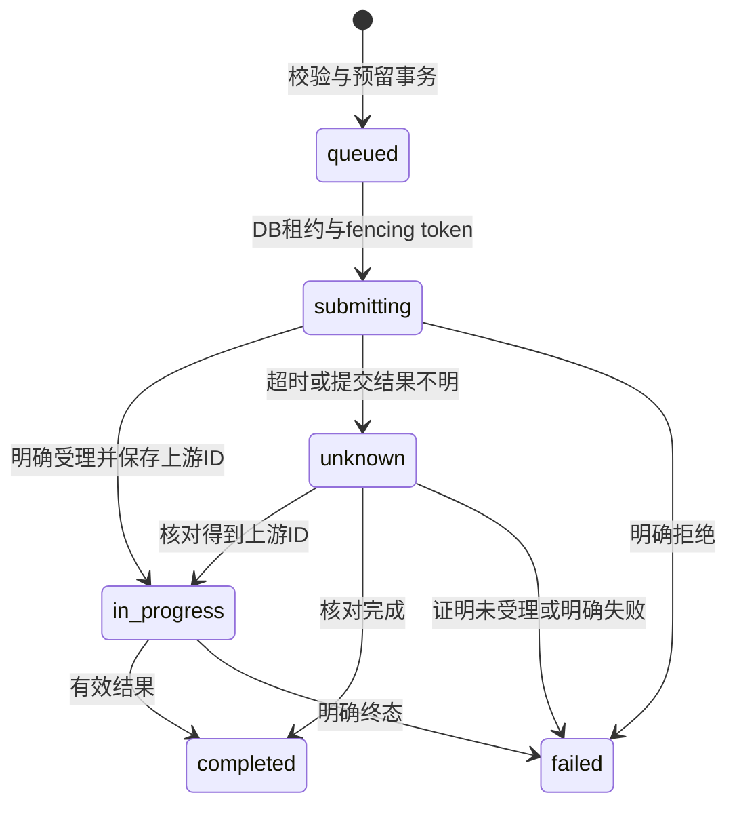

# Sub2API 多模态兼容与可配置计费实施规格

规格版本：`1.0.0-draft`；核验日期：2026-10-12；源码基线：`v0.2.15`。

**已实现媒体运行时、持久化任务与资金预留、版本价卡、估价/模拟器、管理页面、模型广场与使用记录。** 实测范围和供应商费用见 [真实渠道验收](multimodal/REAL_CHANNEL_VALIDATION.md)。38 个能力模板保持关闭，正式售价/成本由管理员填写；未实测模型和未验证输入场景不开放。本文按已实现接口说明；生产发布状态单列记录，不把本地测试称为生产部署。

## 1. 文件、状态与边界

| 文件 | 用途 |
|---|---|
| [OpenAPI](openapi/multimodal-api.yaml) | 本项目下游与管理接口，OpenAPI 3.1 |
| [来源核验](multimodal/RECEIPTS.md) | 19 个云飞章节、V6K 文档/OpenAPI 与源码证据 |
| [能力模板](multimodal/model-capabilities.json) | 14 个云飞模型、24 个 V6K 视频 ID，全部默认关闭 |
| [价卡模板](multimodal/price-cards.json) | 用户售价和供应商成本分开，测试价格、草稿状态 |
| [验收向量](multimodal/billing-vectors.json) | 精确计算输入、预期金额及失败行为 |
| [配置 JSON Schema](multimodal/config.schema.json) | 运行时配置结构，按单条配置保存 |
| [示例说明](multimodal/examples/README.md) | 环境变量、单次提交、持久化恢复及调用方式 |
| [Python 示例](multimodal/examples/media_client.py) / [Node 示例](multimodal/examples/media_client.mjs) | 可执行的估价、同步请求、异步提交/查询/下载客户端 |
| [验证脚本](multimodal/verify_spec.py) | 结构、覆盖、账务验收向量、两个客户端的故障 mock 检查 |
| [本次验证记录](multimodal/VALIDATION.md) | 已执行的规范、运行时与真实渠道检查及验收边界 |
| [生产发布记录](multimodal/PRODUCTION_ROLLOUT.md) | v1.1.1 镜像身份、生产切换、备份与最终验收证据 |
| [规格生成器](multimodal/generate_spec.py) | 重建 YAML、Schema 与 JSON 模板，不访问生产 |

统一进度标签：**源码已有基础、参考服务声明验证、待开发、待渠道验证、本项目实测通过**。另用 VALID / ADJUST / INVALID / UNVERIFIABLE 表示“引述是否符合来源”，两种标签不能互相替代。列表发现、Schema 合法、mock 成功均不能标记“本项目实测通过”。运行时已实现；真实生成仅限验收报告列出的模型与输入场景。

来源：[云飞文档](https://doc.yunfei.best/#top)、[V6K 视频文档](https://www.v6k.top/docs#video)、[V6K OpenAPI 1.1.2](https://www.v6k.top/docs/openapi.json)。它们描述的是参考服务，供应商别名不等于官方模型名称，参考服务报价与退款也不是本项目承诺。

## 2. 源码基础与需要改造的位置

| 源码 | 观察 | 开发要求 |
|---|---|---|
| `backend/internal/server/routes/gateway.go` | 图像、聊天、Grok 视频、Gemini 和 Ark 入口已有基础；视频处理主要绑定 Grok | 增加通用媒体路由分发；保留旧接口返回格式 |
| `service/video_billing_resolution.go` | 时长默认 8 秒、上限 15 秒；分辨率仅 480p/720p/1080p；未知运行时档位默认 480p | 新能力使用模型专属时长、分辨率枚举，不能复用截断与默认档位 |
| `service/openai_gateway_usage.go` | 视频路径在 `video` 模式使用条数×时长，按次模式使用条数 | 不把所有旧路径概括成按次；新媒体类型与计费单位独立 |
| `service/billing_service.go` | `calculatePerRequestCost` 用 `unitPrice == 0` 触发回退 | 新价卡区分 null、零价、正价，缺档拒绝 |
| `service/model_pricing_resolver.go` | 既有价格有共享/default 回退机制 | 新媒体售价不回退 Grok、图像或普通 token 默认价 |
| `service/grok_media.go`、相关 Redis 绑定 | 任务归属、待计费快照等有 Redis 基础 | 新任务以数据库为事实来源，缓存失效不能遗失结算 |
| `repository/usage_billing_repo.go` | 数据库扣费去重、批图冻结/捕获/释放有基础 | 复用事务思想，增加任务、额度窗口、账务状态，不只检查冻结总额 |
| `service/account_stats_pricing.go` | 账号统计可能回退用户倍率前售价 | 新媒体独立成本，缺配置标未知 |
| `service/seedance.go`、`handler/seedance.go` | Ark 原生 content/任务接口有基础 | 保留原协议，Ark 真实 token 单独记录 |
| `service/image_task.go`、`image_storage.go` | 异步图像、存储已有基础 | 接入新持久化引擎时保持原接口兼容 |
| `frontend/src/components/admin/channel/PricingEntryCard.vue` | 已有定价编辑基础 | 扩展价卡版本与模拟器 |
| `frontend/src/components/modelPlaza/PlazaModelPricingTable.vue` | 已有模型广场价格展示 | 显示单位、条件和不退款受理费 |

上述 `service/` 与 `repository/` 均位于 `backend/internal/`。只增加表、可空字段与必要索引；不改已应用迁移校验值，不重算历史账单，不批量解释旧 `video` 标签的真实单位。

## 3. 模型能力与渠道协议

### 3.1 云飞模型

| 精确 ID | 时长/输出 | 输入与差异 |
|---|---|---|
| `gpt-image-2` | 参考分组 1K/2K/4K、medium/high，n=1 | JSON 生成；multipart image/image[] 编辑；URL/Base64 输出；具体 size 字符串按渠道验证 |
| `gemini-3-pro-image-preview` | 1K/2K/4K | Gemini contents.parts 混合 inline_data/file_data；自动比例应省略，不传 auto |
| `gemini-3.1-flash-image-preview` | 1K/2K/4K | 同上，参考服务额外声明8:1、4:1、1:4、1:8，不套用另一个模型的枚举，开放前仍需渠道验证 |
| `grok-imagine-video` | 1–15 秒，默认 8；480p/720p | JSON image.url；multipart input_reference；单图时比例跟随图片 |
| `grok-imagine-video-1.5` | 同上，增加 1080p | 输出实际像素不保证恰好 1920×1080；计费档与实际像素分别记录 |
| `omni-flash` | 4/6/8/10 秒，默认 10 | JSON image 字符串或 images 数组；参考服务固定 720p、16:9；不支持的控制参数报错 |
| `veo-3.1-fast`、`veo-3.1-lite`、`veo-3.1-quality` | 固定 8 秒 | 与 Omni 同协议；不能与 generate-preview 系列合并 |
| `veo-3.1-fast-generate-preview`、`veo-3.1-generate-preview` | 4/6/8 秒；720p；16:9/9:16 | image_url 单图；image_urls 恰好两图时首尾帧；generate_audio/negative_prompt 别名 |
| `veo-3.1-generate-preview-ref` | 无图 4/6/8；带图固定 8 秒、16:9 | image_urls 多参考图，最大数量未公布，配置前不开放 |
| `lyria-3.5`、`lyria-3-pro` | 时长提示不保证真实时长 | Chat 非流式纯音乐为来源声明验证；专用 audio/music 路径来源标为 404，SSE/歌词扩展待验证 |

云飞 19 场景：gpt-text、gpt-edit、banana-text、banana-edit、grok-video-submit、grok-video-image、grok-video-result、omni-video-submit、omni-video-image、omni-video-result、veo-text、veo-image、veo-frames、veo-ref、audio-chat、audio-submit、audio-compat、audio-models、audio-endpoints。能力模板保留对应场景和来源定位。

不能将 Gemini `responseModalities=["TEXT"]` 返回图像 URL 的渠道约定当作官方普遍行为；按 part 字段遍历，不依赖固定数组下标。音乐保留 `choices[].message.content` 的文字链接与 `data[]` 的 URL、download_url、duration、title、expiry；SSE 是文字进度与结果，非音频播放流。未知或缺失真实时长应为 null。

### 3.2 V6K 全部 24 个模型

| ID（必须原样保存） | 来源声明的能力 | 未知项/限制 |
|---|---|---|
| `00sd2.0` | 5/10/15 秒，默认 5；最多 10 图，公网 URL 对象 | 省略 resolution；不接收参考视频/音频；比例枚举待核实 |
| `00sd2.5` | 固定 30 秒；最多 10 图，公网 URL 对象 | 省略 resolution；不能截成 15 秒；比例枚举待核实 |
| `XXsedanco2.0`、`XXsedanco2.0mini`、`XXsedanco2.0S`、`XXsedanco2.5S`、`wan3.0` | seconds 必填；公网 URL 字符串/对象素材 | 时长枚举、素材类型及上限待渠道配置 |
| `seedance-mini`、`seadanco-oplu-480`、`seadanco-oplu-720`、`sedanco-2.5-AM`、`dola2.5` | seconds 必填，分辨率与模型匹配 | 不从 ID 猜测实际能力，缺范围默认关闭 |
| `video-QY` | 视频编辑，必须有参考视频 | 其他约束待配置 |
| `doubao-seedance-2-0-65Z`、`doubao-seedance-2-0-fast-65Z`、`doubao-seedance-2-0-mini-65Z`、`doubao-seedance-2-5/65Z` | seconds/ratio/resolution，metadata.content 原生素材 | `/` 与大小写保留；原生内容必须解析校验计数与所有权 |
| `JSadanco2.0` | seconds 可选；最多 9 图；URL、对象、Data URL | 时长、分辨率待配置 |
| `LLseadanco2.5` | 固定 30 秒、720p；最多 30 图；URL/对象/Base64/Data URL/multipart | 单张 ≤30 MiB；总请求限制独立配置；公网取图超时 60 秒按来源规范 |
| `F720seadanco2.5`、`F480seadanco2.5`、`FF720wan3.0`、`FF1080wan3.0` | 仅 JSON；reference_*_urls 别名 | 时长、素材上限和分辨率待核实 |
| `MinimaxH3-2K` | 4–15 秒，默认 15；2K/768p；最多 9 图、3 视频、3 音频；JSON/multipart | 输入视频/音频时长与大小上限待配置 |

V6K OpenAPI 的通用正整数上限不是模型支持时长承诺。模型列表只表示访问权限。涉及未知能力的场景必须单独保持关闭；不得依据模型名自动选择售价。模板中的 null/待验证不表示无限制。

### 3.3 通用参数归一化

下游保留来源协议字段，内部归一为有序 `references[]`：media_type、source_kind、url/object_key、role（reference/first_frame/last_frame）、ordinal、可信测量时长。公共规范不要求客户端自行猜测原生字段。

- duration/seconds、ratio/aspect_ratio、size/resolution、generateAudio/generate_audio 等只在能力明确允许时归一化；两项都出现且不同返回 400，同值合并一次。
- Omni 的 image_url 等错误图片字段明确报错，不按文生降级并扣费。不支持的比例/分辨率/音频控制同样报错。
- 上限与必填条件先校验，再估价、预留、提交；模型固定 30 秒拒绝其他时长。
- 多素材顺序、@图1 等标记、首尾帧角色原样保存；metadata 不能覆盖模型、所有权、价格、计费数量。metadata.content 与普通 refs 同时传入须定义合并语义；默认拒绝冲突来源，不能绕过素材计量。
- multipart boundary 由 HTTP 客户端设置；文件 MIME/魔数、单文件与解码后总大小、图片像素均有有限上限。Base64 不长期进入 DB/Redis；只存参数摘要、受控对象引用和校验 hash。
- 取图/下载防 SSRF：协议、域名白名单、DNS 解析及每次重定向校验、拒绝私网/元数据地址；凭证仅发绑定渠道 API，不发 CDN。探测任务隔离、限时限内存；限制重定向数和响应体。
- Ark 原生路由及 content[] 扩展继续按原契约，不因新严格通用校验改变无关旧请求。

## 4. 下游契约

所有路径从自己的 Sub2API 站点根地址拼接；路径已含 /v1，不能重复添加。沿用 Key 权限、分组与限流；任务必须同时校验用户、Key 归属以及创建时绑定账号。未启用能力仍按现有路由/功能门控响应，不承诺新增端点已在线。

| 方法/路径 | 当前基础 | 目标行为 |
|---|---|---|
| GET /v1/models | 源码已有基础 | 只返回当前 Key 可用 ID；扩展能力信息不等于实测完成 |
| POST /v1/images/generations | 源码已有基础 | 同步 JSON 图像；按模型能力补齐 |
| POST /v1/images/edits | 源码已有基础 | 同步 multipart 单/多图编辑 |
| POST /v1beta/models/{model}:generateContent | Gemini 路由已有基础 | 原生图像协议，保留结果结构 |
| POST /v1/videos | Grok 已有基础 | 新通用配置走本地持久化任务，202；旧路径行为保留 |
| GET /v1/videos/{id} | Grok 已有基础 | 通用任务状态，查询免费 |
| GET /v1/videos/{id}/content | Grok 已有基础 | 受控取片；查询/下载不再次生成 |
| HEAD /v1/videos/{id}/content | 已实现，按模型门控 | 无响应体；能力允许时提供长度、类型、ETag/Range |
| GET /v1/tasks/{id}/artifacts | 已实现，按模型门控 | 有序去重制品列表 |
| GET /v1/tasks/{id}/artifacts/{key}/content | 已实现，按模型门控 | 指定制品代理下载 |
| POST /v1/chat/completions | 聊天已有基础，Lyria 待验证 | 音乐声明支持才开放；保留 data[] 与 SSE 扩展 |
| POST /v1/audio/generations、/v1/music/generations | 已实现本地入口，上游采用已验证 Chat 音乐协议 | 共用实现；async=true 为 202，false 等待结果为 200 |
| GET /v1/audio/generations/{id}、/{id}/content | 本项目新增、已实现，按模型门控 | 音乐查询/首个音频下载 |
| POST /v1/sub2api/estimates | 本项目新增、已实现，按模型门控 | 只估价，不调用上游、冻结或扣费 |

新通用异步响应示例（价格仅为测试）：

```json
{"id":"mt_example","object":"video","model":"00sd2.5","status":"queued","progress":0,"billing":{"currency":"USD","reserved":"1.00000000","maximum_charge":"1.00000000","price_version":"test-v1","accepted":"0.00000000","settled":"0.00000000","released":"0.00000000","refunded":"0.00000000","state":"held","version":1}}
```

任务公开状态 queued/in_progress/completed/failed/unknown；生成完成与结算状态分别返回。completed 可以仍待用量核对；unknown 是受理不明，不伪装 failed。账务状态 held/pending_usage/settled/released/manual_review。响应不暴露供应商 Key、签名参数、成本价卡或原始请求素材。progress 不承诺 ETA。

估价请求包含 `operation` 和 `request`（完整参数，multipart 用已经验证的素材摘要）；身份/分组从 Key 获取，不能由客户端指定。返回命中价卡、计费项、倍率、估计范围、最高收费、不退基础费与缺失用量。估价不锁价；正式创建重新解析、锁定并返回最终预留信息。只向管理员模拟接口开放账号/分组/时间覆盖与成本数据。

| HTTP/错误码 | 新契约含义 | 重试要求 |
|---|---|---|
| 400 invalid_parameters / alias_conflict / unsupported_capability | 提交前拒绝 | 修正后用新的幂等键；未预留、未生成 |
| 401/403 | Key/权限失败 | 不重提，先解决身份 |
| 402 insufficient_funds / quota_exceeded | 可用余额/在途额度不足 | 未创建收费任务 |
| 404 task_not_found | 不存在或无归属权限 | 不泄漏其他用户任务 |
| 409 idempotency_conflict / version_conflict / artifact_not_ready | 参数不同、并发覆盖、尚未取片 | 查询原任务或刷新配置 |
| 410 artifact_gone | 链接失效且不能刷新 | 不自动重新生成 |
| 422 price_not_configured / reservation_unbounded | 无有效价卡/上限 | 管理员修复前不开启 |
| 429 | 限流 | 查询退避，遵守 Retry-After |
| 502/503/504 | 临时失败或受理不明 | 已有 ID 则只查询；提交无 ID 不盲目重提 |

生成接口客户端检查全部 2xx，随后验证 JSON 对象、非空 ID 和状态；HTTP200 的 HTML/缺 ID 不算成功。HTTP200/status=failed 是失败终态。新引擎已经落库后应尽力返回本地 ID（含 unknown）；客户端无 ID 时保留 pending_submission 记录、幂等键、请求 hash，进入人工核对。不同供应商不共享幂等能力；不得因换账号而重提未知任务。

下载：普通 GET 为200；Range 在能力支持时为206，携带 Content-Range；无效范围416，`Content-Range: bytes */N`；不支持范围可返回完整200，不能伪造206。HEAD无响应体。304仅用于支持条件请求的渠道。下载尚未就绪409，失效410。相对上游制品地址按绑定账号 base URL 安全解析，不按客户端 Host 解析。平台返回自己的鉴权制品路径；不要把可访问签名 URL写日志或给跨域下载附 Key。

## 5. 价卡与精确计算

### 5.1 身份、版本与单位

价卡包含：price_id、不可变 version、purpose（sale/cost）、模型/别名/最长前缀匹配、分组/渠道/账号作用域、operation、media_type、USD、草稿/启用/停用、生效时间、显式条件优先级、收费项、时长规则、预留上限、审计摘要和来源。共享模板通过明确链接绑定，修改产生新版本，不原位改旧版本。

| 单位 | 原始数量 | 展示 |
|---|---|---|
| request | 成功一次任务为1；accepted项只在确认受理后为1；查询下载为0 | 美元/次 |
| output | 有效成功制品数；排除缩略图和重复链接 | 美元/张、条、首 |
| second | 请求/固定/实际/上游计费时长 | 美元/秒 |
| minute | 先处理秒数，再除60 | 美元/分钟 |
| token | 上游白名单 usage 中指定 token，不估造 | 美元/百万 token |
| input_image | 被接受参考图片数 | 美元/参考图 |
| input_video_second | 被接受视频素材时长 | 美元/素材秒 |
| input_audio_second | 被接受音频素材时长 | 美元/素材秒 |

模板中 token `unit_price` 按每 token 存储，界面×1000000展示；其它单位按一个单位存储。token项的`usage_field`分别指定适配器白名单归一字段，例如image_input_tokens/image_output_tokens；缺任一字段保持待结算，不能两项都使用total_tokens。混合项只按配置显式叠加，不自动再加普通 token 费用。定价 identity 与匹配参数由服务端确定，metadata 不可信。

### 5.2 匹配

售价：分组模型媒体价卡 → 分组所属渠道模型媒体价卡 → 明确关联共享模板 → 缺配置拒绝。每层精确 ID → 显式别名 → 最长前缀。相同优先级冲突拒绝发布，条件按显式优先级先命中，默认条件必须显式写。2K 未配不回退480p/最低价。旧媒体价卡仍走兼容解释器，开启新价卡后单次账单只能使用一个解释器。

成本：账号专属 → 匹配账号/分组成本规则 → 渠道成本模板 → 未知。成本没有售价回退。能力/价格有效与实测结果是三个独立开关，模型对用户开放要求全部满足；新增能力必须补价格后才能开放。

### 5.3 金额精度、时长与分档

配置金额、数量、倍率为十进制字符串。单价最多12位小数；拒绝负数、NaN/Infinity、非法单位及相互冲突规则。`null` 未配置，`"0"` 显式免费。使用 Decimal，保存项原值；全部项及倍率相乘后仅对总额做一次8位小数 ROUND_HALF_UP 量化，禁止逐项四舍五入后求和。数据库资金保持现有8位。显示尾差不改变扣款。

每一时间项独立选择 request_duration / fixed_duration / artifact_duration / provider_duration；原始请求、产物实测、供应商计费和最终收费时长分列。provider_tokens 只读适配器白名单 usage。缺实际时长进入 pending_usage、重试探测；缺 token 不当0。备用来源必须明确配置并公示，默认无备用。

取整 none/ceil/floor/half_up；默认 none、minimum=0。step 是秒单位，time 项逐产物取整为默认，也可 aggregate。向上公式 `max(minimum, ceil(raw_seconds/step)*step)`；minute 在这之后÷60。duration=61、step=60、0.6美元/分钟→2分钟→1.2美元；不取整→61/60分钟。非时间数量（token/张/次）规则同样在原始数量单位执行，不能以秒解释。

套餐档（package）：条件如4/8/30秒命中不同**总价**。累进档（progressive）：明确不重叠连续区间，分段数量×单价求和；例如前10秒0.04、超过10秒0.02，30秒为0.8美元。档位金额不是分段单价。图像尺寸×质量、Grok版本×分辨率、Minimax768p/2K、Veo文生/单图/首尾帧/多图可分别配置条件；每种已开放条件须覆盖。

### 5.4 倍率

`用户应付 = Σ收费项金额 × 有效媒体倍率 × 分时倍率`。

沿用图像/视频独立倍率选择：媒体覆盖开启时**替代**用户/分组基础倍率，关闭时使用现有有效倍率；音乐新增对应开关。不叠加两套基础倍率，不默认加推理等级倍率。分时机制复用既有时区；预留时锁住价卡、成本卡、能力、倍率、时间段和资金来源。调价、换分组、跨峰谷不重算旧任务；查询与下载没有生成费。

### 5.5 成本与毛利

用户售价与成本可使用不同单位、取整、时长和失败触发。来源 cost_status=unknown（未配置/关键用量缺失）、estimated（配置×观测量）、verified（供应商账单/明确回执核对）。income 为真实结算减退款；成本估算时写“估算毛利”，未知不显示数值；失败上游支出不因用户退款消失。账号成本倍率只应用一次，不乘用户分组倍率。供应商价格变化也只影响新快照，后续账单调整另记记录。

## 6. 持久化任务与账务实现规格

### 6.1 新表（已实现，生产迁移状态见发布记录）

| 表 | 关键字段/约束 |
|---|---|
| media_config_versions | kind+id+version 唯一；能力与价卡 JSON、发布状态、修改人；旧版本不可变 |
| media_config_heads | kind+id 唯一；当前编辑版本与已发布版本分别记录 |
| media_tasks | 本地随机ID、user/key/group/subscription、资金窗口、模型/operation、绑定账号、上游ID、execution/settlement状态、request_hash、幂等键、快照、观察期限、租约owner/until/epoch、重试时间 |
| media_artifacts | task_id+key唯一；类型、MIME、大小、hash/供应商稳定ID、实测时长、受控地址或对象key、到期/刷新状态；敏感地址加密 |
| media_quota_holds、media_quota_windows | 任务额度持有与窗口汇总；套餐/Key/平台预留、remaining；原资金来源不可变 |
| media_ledger_entries | operation_key唯一；task、类型reserve/accepted/capture/release/refund/compensation、8位金额、规则快照、数量与原值、管理员理由、原账务引用 |
| media_cost_entries | 独立成本、unknown/estimated/verified、用量/供应商账单来源、账号/分组、调整版本，不覆写收入 |
| media_tasks.cache_dirty | 与资金事务一起标记；worker 持续刷新余额、套餐与 Key 缓存，失败保留标记重试。媒体使用记录由任务与账本提供 |

关键索引：`(key_id, canonical_operation, idempotency_key)` 唯一（无幂等键允许null）；`(adapter, account_id, upstream_task_id)` 非null唯一；`(execution_state, next_poll_at, lease_until)`；账务操作键唯一；退款引用索引。制品无权访问返回404。未完成账務引用禁止级联删除；可软删除配置。素材不长期存大 Base64。

### 6.2 状态与 worker



worker使用数据库 `FOR UPDATE SKIP LOCKED`/租约及epoch阻止过期worker覆盖；Redis只缓存/唤醒。**租约到期不能证明上游没有受理**：submitting中断后的新worker先核对，不重新POST。供应商支持幂等/按外部ID查询时使用本地ID；否则停在unknown人工查账。HTTP在途预留与任务预留使用不同命名空间，新路由不得两次冻结。后台持续轮询，不依赖客户端GET；查询临时错误不置failed，超过观察期限转manual_review，不能仅靠TTL扣款/释放。

步骤：鉴权 → 参数/能力校验 → 售价/成本解析 → 计算有限费用上限 → 一个DB事务创建任务并预留所有资金/额度 → worker提交一次 → 保存绑定账号/上游ID/确认受理事件 → 后台查询 → 记录去重制品及可信usage → 事务结算/释放余量与outbox → 幂等usage/cache更新。同步图像、非流式音乐及SSE等待同一引擎结果，不另起计费路径。

### 6.3 预留与资金不变量

固定次/套餐/请求时长预留可确定金额；实际时长/token必须配置有限最大数量或USD任务上限。所有组合项最大值合计，含倍率和分时；无上限拒绝开放。显式免费不冻结，但仍限流、记任务。用户最大收费在创建时锁定且公示，实算超预留时最多扣上限、记录异常和全部上游成本，平台承担差额，不自动追加负余额。

兼容现有余额语义：reserve 从 available balance 扣、加 frozen；capture 从 frozen 消耗，余款还available；release仅退尚未结算冻结。不能将`balance-frozen`再次作为可用余额双扣；开发前以现有repo为准。余额、套餐日/周/月窗口、Key总额度/金额限额、平台额度分别锁相应行，以实际用量+在途预留判断能否创建。按固定顺序锁：user→subscription/window→key→platform→task，避免死锁；失败全部回滚。

每任务要求：`reserved_total = accepted_captured + success_captured + released + remaining_hold`，每笔非负；`refund_total <= accepted_captured + success_captured`（不超过允许退且未退余额）；额度与对应资金变动同事务。accepted费即使已扣，也从总上限消耗，不额外叠加。默认success全部失败→capture0/release全额。accepted可在确认受理时捕获一次，其余冻结继续持有，失败只释放余量。

capture和release锁任务/hold行，检查最终账务状态并写唯一operation_key（`task:reserve`、`task:accepted`、`task:finalize`、`task:refund:<request-id>`）；最终成功/失败只能执行一次finalize。refund按原capture记录作追加分录，乐观版本/锁和唯一退款幂等键防重，人工补偿另记compensation。不要仅用Redis锁去重。供应商成本单独入账。

套餐到期、Key停用、用户余额降低不丢弃已受理任务；结算到创建时原窗口，不自动改扣余额。套餐已结束窗口的计费与当前窗口独立。配置删除保留快照；保留必要Key所有权引用。最终DB已提交但cache失败由outbox恢复，账务不能因cache失败再扣。使用记录以task_id唯一写入生成事件，查询下载只写运维日志。

### 6.4 成功、失败与部分产物

收费项触发success（默认）或accepted（仅明确受理、管理员发布并公示）。网络超时不算accepted。至少一个有效制品成功，按次收一次；按产物/实际时长仅收成功产物。支持all_outputs_success策略。重复URL、下载别名、缩略图不计新产物；优先稳定供应商ID/hash去重，不能只比较URL。

如果已完成但链接后来过期，不自动退款；如果平台处理故障导致始终没交付有效结果，按失败规则释放/退款，独立保留上游成本。缺usage待结算，不当0；管理员核对需要证据、动作、操作者、原快照及审计，不提供任意篡改账单接口。

## 7. 后台、管理接口与用户展示

扩展账号/渠道编辑：adapter、exact_model/upstream_model、场景开关、JSON/multipart、文件限制、有序角色、时长/分辨率/质量、HEAD/Range/刷新、并发/查询间隔/观察期限、来源及实测结果。

扩展分组/渠道价卡：简单单项（次/产物/秒/分钟/token）与高级组合项、条件档、时长来源与步长、accepted不退费、有限预留上限；售价/供应商成本分区；草稿→验证→发布；版本diff；JSON导入导出；批量操作仅影响选择模型。历史任务快照不可修改。共享模板更新产生新版本，旧绑定必须显式升级。

管理接口均位于 `/api/v1/admin`，沿用管理session/权限/敏感操作认证（其现有token并非下游Key）：

| 路径 | 行为 |
|---|---|
| GET /media/configs/capability、/media/configs/price | 当前配置；`?id=...` 返回历史 |
| POST /media/configs/capability、/media/configs/price | `id, expected_version, publish, config`；false 保存草稿，true 发布版本 |
| POST /media/configs/{kind}/disable | `id, expected_version`；新增停用版本 |
| POST /media/simulate | 复用实际结算计算器；无生成和资金操作 |
| GET /media/tasks | `user_id, limit, before`；分页管理任务 |
| POST /media/tasks/{id}/reconcile | `upstream_id, decision, evidence, expected_version`；绑定原任务查询或核实失败释放 |
| POST /media/tasks/{id}/refund | `amount, reason, expected_version` 和 Idempotency-Key；可退款成功项上限，不退受理费 |
| POST /media/tasks/{id}/cost | `amount, evidence, expected_version` 和 Idempotency-Key；账单核实成本，不改售价 |

用户自己的任务入口为 `GET /api/v1/media/tasks`。管理写操作继续经过管理员鉴权、审计和现有敏感操作验证。

模型广场显示接口/能力、价格单位、档位、倍率、例价和accepted不退规则。使用记录显示task_id、请求/实际/上游/最终时长、制品数、收费项/单位、预留/结算/退款、版本/倍率；用户不见成本和供应商密钥。管理员成本未知显示未知，估算显示估算毛利。模拟输出逐项数量/取整/单价/金额、命中规则、倍率、最高预留、缺项/冲突，不能调用上游或扣费。

## 8. 用户调用手册

新增入口受能力和价卡发布门控；先查看真实验收记录并配置账号、分组与价格，再使用示例。环境变量 `SUB2API_BASE_URL` 填站点根，`SUB2API_API_KEY` 填自己的下游Key，不能填供应商Key。不要在参数/日志/状态文件保存Key。

```powershell
$env:SUB2API_BASE_URL = 'https://your-sub2api.example'
# 在本地环境配置 SUB2API_API_KEY，不将真实值写入文档或Git。
python docs/multimodal/examples/media_client.py models
python docs/multimodal/examples/media_client.py estimate --payload request.json
python docs/multimodal/examples/media_client.py submit --kind video --payload sd25.json --state task.json
python docs/multimodal/examples/media_client.py resume --state task.json --output result.mp4
node docs/multimodal/examples/media_client.mjs resume --state task.json --output result.mp4
```

`sd25.json`（参考图地址换成自己的公开地址，也可删除images仅文生）：

```json
{"model":"00sd2.5","prompt":"参考图中的人物缓慢转身","seconds":30,"images":[{"url":"https://example.com/reference.jpg"}]}
```

`request.json`（已实现估价）：

```json
{"operation":"video","request":{"model":"00sd2.5","prompt":"镜头缓慢推进","seconds":30}}
```

其它请求文件：

```json
{"model":"grok-imagine-video-1.5","prompt":"静止镜头，树叶轻轻摆动","duration":6,"resolution":"1080p","image":{"url":"https://example.com/first.png"}}
```

```json
{"model":"veo-3.1-generate-preview","prompt":"自然过渡","duration":8,"aspect_ratio":"16:9","image_urls":["https://example.com/first.jpg","https://example.com/last.jpg"]}
```

```json
{"model":"lyria-3.5","prompt":"钢琴纯音乐，无人声","instrumental":true,"audio_format":"mp3","async":true}
```

同步图像与非流式音乐Chat用 `call --endpoint images/generations|chat/completions --payload ... --output result.json`；Gemini用 `call --endpoint gemini --model gemini-3-pro-image-preview`，payload是contents/generationConfig；multipart编辑用`edit --payload edit.json --image first.png --image second.png --output image-result.json`。JSON payload的model/prompt/n等按模型能力填写，不能手填Content-Type boundary。SSE扩展待渠道验证，不在示例中伪装已可用。

示例在提交网络请求前以排他创建方式写state和幂等键，再单次POST；任何断网/HTML/无ID保留unknown，不自动重提。恢复只GET查询和同站点content下载；临时查询/下载故障不变生成失败。轮询默认20秒、有界运行；超时保留ID，重新resume；原生成继续后台执行。state无凭证，但包括任务身份/请求摘要，仍需保护。同一state不可被并发进程操作；两种客户端state格式互通。示例下载不跟随重定向，避免泄露Key；有效下载原子落盘，验证MIME/签名并限制大小。

## 9. 配置示例与账务验收

v1.1.0 后台可按模型模板创建草稿；批量导入采用 `{"capabilities": [...], "prices": [...]}` 信封，来源文件中的 `profiles`/`cards` 分别放入对应数组。`enabled=false`、`draft`、`price=null` 保持未配置语义。price-cards 中的数值全部 test_only，不是正式售价。管理员应补渠道 adapter、实际素材/请求限制、真实售价/成本/预留、验证证据，再通过发布检查；不把测试样例发布到生产。

建议：图像按成功张/质量尺寸档；Grok按秒/分辨率；Omni/Veo按次或请求时长套餐；00sd2.5/LLseadanco2.5按30秒套餐或每秒×30；Minimax按秒/2K与768p；Ark成本用真实token；Lyria按次/首或实际分钟。受理费默认0、不自动启用。

| 测试场景 | 输入/规则 | 预期 |
|---|---|---|
| SD2.5按次 | 30秒、1美元/次 | 1美元 |
| SD2.5按秒 | 30×0.04 | 1.2，不截15秒 |
| 分辨率匹配 | 6秒×720p0.02或1080p0.04 | 0.12与0.24 |
| 取整 | 6.2秒、ceil step1 | 7秒 |
| 音乐分钟 | 61秒、step60、0.6/分钟 | 1.2 |
| 组合项 | 0.2+30×0.03+2×0.05 | 1.2；倍率只应用一次 |
| 售价成本独立 | 售价1；成本30×0.02 | 收入1，估算成本0.6，估算毛利0.4 |
| 零价/缺价 | 720p显式0；2K=null | 前者0，后者拒绝 |
| 默认失败 | hold1、未受理费 | release1、charge0 |
| 受理后失败 | accepted0.2 + success其它 | 仅charge0.2 |
| 超上限 | raw1.2、cap1 | charge1，告警0.2 |
| 创建后调价 | v1=1、v2=2 | 旧任务1 |
| 累进 | 前10秒0.04、后20秒0.02 | 0.8 |
| 精度 | 全部项/倍率求和后一次量化 | 以向量中的Decimal结果为准 |

运行时集成测试覆盖：无人轮询仍结算、同幂等键20次只一任务、失败/成功竞争、余额/套餐/Key/平台额度不超卖、部分产物、accepted只一次、退款超额拒绝、cache失败恢复、租约过期不重提、跨时间档/套餐窗口、管理员改价快照、供应商支出不随退款消失。规范算术验证与 Go 运行时测试分别记录，见 VALIDATION.md。

## 10. 开发拆解、验收与上线

| 阶段 | 后续工作/依赖 | 退出条件 |
|---|---|---|
| 1（本次） | 三份主文档、能力/价卡/Schema、可执行示例与验证 | 38模型、19章节覆盖，规范可解析，mock行为通过，未知标清 |
| 2 | Decimal价卡解释器、匹配冲突验证、估价/模拟API；无上游副作用 | 所有单位/组合/分档/零价/12位/8位/倍率/缺价测试通过 |
| 3 | 新表、事务预留/ledger/outbox、租约、后台恢复；依赖2 | DB并发与断点故障注入，账务对账无差异 |
| 4 | 通用视频adapter，先00sd2.5和LLseadanco2.5；依赖2/3 | 两渠道实生成/取片/恢复，按次/秒30秒准确 |
| 5 | Grok/Omni/Veo及其余V6K模型 | 每个开放模型真实生成+下载+费用；未知模型保持关闭 |
| 6 | 图像补齐、Lyria专用/Chat/SSE、混合素材与usage | 每种开放场景实测；来源404端点不得直接上线 |
| 7 | 能力/定价后台、模拟器、模型广场/使用记录/审计 | 展示、估价、结算一致；权限及批量修改正确 |
| 8 | Go单元/DB集成、前端类型/测试/构建、迁移演练、发布准备 | 下列门禁通过，待单独生产批准 |

完整兼容回归：19云飞场景+24V6K配置；JSON/multipart、URL/DataURL/Base64及顺序、多图/首尾帧/编辑；含斜杠ID、别名冲突、数量与大小边界；音乐非流式/SSE保留字段；HTML200/缺ID/失败200/unknown；GET/HEAD、Range206/416、304、410、相对地址/凭证隔离。

故障注入在reserve→提交→上游受理→保存ID→产物完成→结算/outbox各断点kill进程；多worker租约、Redis不可用、DB暂不可用、上游重复状态、账务竞争、下载失效及探测超时。检查任务不会无依据重提，所有金额精确对账。

真实渠道联调需管理员提供已配置凭证与测试预算；不得借用生产Key试收费。每开放模型至少一次生成、恢复/查询、文件有效性及费用核对；多图/首尾帧另测。mock与模型发现不能签为实兼容。当前核验不产生任何生成费用。

上线另行决定：备份副本迁移并核对用户/余额/冻结/Key/套餐/旧价卡；检查生产定价覆盖服务只同步旧字段，不能覆盖新价卡。新增功能默认关闭；关功能代码可在扩展DB运行。私有镜像不可变digest、prepare、应用容器受控upgrade；不重建Postgres/Redis/网络。

回滚：先关闭新提交，保持新版worker处理已创建任务；确认unknown/pending_usage和冻结账务，排空或有受控兼容worker之后才能换不能识别新任务的旧镜像。回滚代码不删新表，不覆盖生产数据。本阶段不申请迁移或切换，不执行任何生产写操作。


## 本轮实现边界与操作要点

- 新模型默认关闭。不能将隔离测试中的 1 USD 价卡、临时 5 秒能力或测试 Key 导入生产。模型配置缺少实测证据、有限素材限制、时长或有效价卡时，提交被拒绝。
- GPT 图像配置像素尺寸 `sizes`；图像编辑支持单图和 `image[]` 多图 multipart。某次多图上游 504 进入人工核对，禁止将它当作成功或重新提交。
- 音乐专用本地接口与 Chat 音乐共用执行和结算，供应商使用已验证 Chat 路径；SSE 输出完成消息块和制品路径，不声称是增量音频流。
- 请求和原始结果存于 `/app/data/media` 的加密文件，需保留 JWT secret 与持久数据目录；制品供鉴权下载。视频/音乐由 ffprobe 核验流类型与时长，图像需可解码。
- 退款只允许原成功收费中 refundable 项；发生最高收费封顶时按原收费项比例分配可退款金额，受理费不退。退款不会改写原使用账单。
- 发布先备份与副本恢复，单独演练/执行 `243_media_tasks_and_pricing.sql`，随后仍需普通 prepare 和 upgrade。新媒体未开放且无在途媒体任务时，演练过的旧运行时可用扩展数据库；一旦有在途新任务，不直接回退旧镜像。
